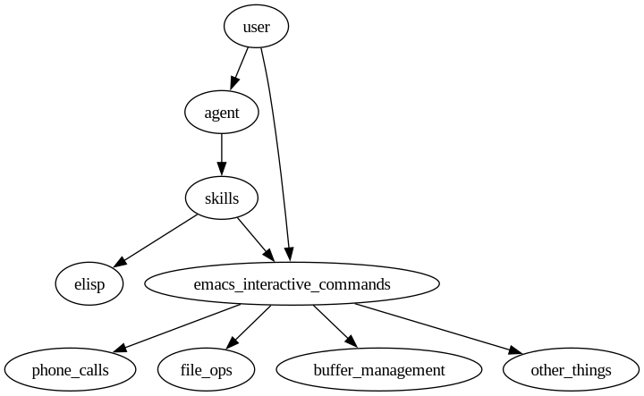

#+title: EmacsOS

EmacsOS is a malleable, agent-customizable, local-first operating system built on Emacs, for small touchscreen devices. The phone is the user's most personal device, and they should be able to do anything they need to on it. The principles guiding this project include:
- Malleable - Emacs is the substrate, so every keybinding, buffer behavior, and display rule is just elisp that can be changed at runtime. See [[https://malleable.systems/][malleable.systems]].
- Agent-customizable - Editing elisp on a 320x240 screen with a T9 keyboard is miserable, so an agent does it instead, driven by natural language like "set up gnus for my gmail", with single-tap roll-back to any prior version. Design: [[file:docs/2026-05-12-agent-driven-customization.org][docs/2026-05-12-agent-driven-customization.org]].
- Local-first - The user's data, configuration history, and decisions stay on machines they own. No mandatory cloud, no remote service the phone depends on to keep working.

* Quick Start

#+begin_src sh
make start
#+end_src

This launches Emacs in a 320x240 pixel window with no user configuration loaded — only =os.el=.

It runs as a *separate Emacs process* (=emacs -Q= skips your =init.el=, site-lisp, and startup screen), so it is a self-contained simulator you can run on your dev machine — including as a window alongside another Emacs session, e.g. under an EXWM desktop — without touching your own configuration. Do *not* =load-file os.el= into your everyday Emacs as a shortcut: =os.el= rebinds keys, registers hooks, and resizes the frame, so it must run in its own =emacs -Q= process to stay isolated.

The chat panel POSTs to =emacsos-chat-server-url= (default =http://localhost:8765/chat=). For pure UI/layout work no server is needed; to make the simulator actually reach an agent, run a [[*Chat Server][Chat Server]] and point that variable at it.

* Features

** Virtual Keyboard

A virtual keyboard is displayed in a dedicated window at the bottom of the frame. The layout follows the *Optimal-T9* design from [[https://doi.org/10.1145/3279778.3279786][Qin et al., ISS 2018]], a 3x3 multi-letter key layout optimized for clarity, speed, and learnability on small touchscreens.

#+begin_example
[ qw ] [ertyui] [ op ]
[ as ] [ dfgh ] [jkl ]
[ zxc] [ vbn  ] [ m  ]
[  SPC   ] [RET] [DEL]
[ caps]
#+end_example

- *Multi-tap input*: tap a key to type its first letter, tap again quickly to cycle through the remaining letters on that key. After a 1-second pause, the current letter is committed.
- The keyboard is non-editable and does not steal focus — typed characters are inserted into the editing buffer in the top window.
- *CAPS* toggles uppercase input.

* Remote Development

EmacsOS can be controlled from another device over the network — useful for testing on a phone with no physical keyboard.

** On the phone (target device)

Start EmacsOS with the server enabled:

#+begin_src sh
make start-server
#+end_src

This launches EmacsOS and starts the Emacs server listening on all interfaces (TCP). An auth file is written to =~/.emacs.d/server/server= containing the port and authentication key.

The same command works for a *local simulator*, not just the phone — run =make start-server= on your dev machine and you can drive the simulator's buffers from your everyday Emacs exactly as below. The auth file is already local (no =scp= needed); it still records =0.0.0.0=, so rewrite that to =127.0.0.1= if your =emacsclient= won't connect to =0.0.0.0=.

** Sending eval expressions (TCP, no SSH)

Copy the auth file from the phone and fix the address:

#+begin_src sh
scp phone:~/.emacs.d/server/server ./server-file
sed -i 's/0\.0\.0\.0/192.168.1.42/' ./server-file   # use the phone's actual IP
#+end_src

Then evaluate expressions directly from your dev machine:

#+begin_src sh
emacsclient -f ./server-file -e '(buffer-name)'
#+end_src

** Opening a full terminal frame (SSH)

=emacsclient -t= requires the server to access the client's TTY device, which doesn't work across machines over TCP. Use SSH instead — =emacsclient= runs on the phone and the terminal renders over the SSH connection:

#+begin_src sh
ssh -t phone emacsclient -t
#+end_src

This gives you a full Emacs frame in your terminal, sharing all buffers and state with the phone's EmacsOS session.

** Examples

*** Typing via the virtual keyboard

The =emacsos--tap-key= function handles multi-tap and inserts into the correct buffer:

#+begin_src sh
emacsclient -f ./server-file -e '(emacsos--tap-key "qw")'    # types "q"
emacsclient -f ./server-file -e '(emacsos--tap-key "qw")'    # cycles to "w"
emacsclient -f ./server-file -e '(emacsos--tap-space)'        # space
emacsclient -f ./server-file -e '(emacsos--tap-return)'       # exit minibuffer; otherwise run the target buffer's RET command
emacsclient -f ./server-file -e '(emacsos--tap-backspace)'    # delete backward
#+end_src

*** Direct buffer manipulation

#+begin_src sh
emacsclient -f ./server-file -e '(with-selected-window (emacsos--target) (insert "Hello from remote!"))'
emacsclient -f ./server-file -e '(with-selected-window (emacsos--target) (erase-buffer))'
#+end_src

*** Running commands

#+begin_src sh
emacsclient -f ./server-file -e '(emacsos--run-command #'\''find-file)'   # run a command in the editor
emacsclient -f ./server-file -e '(emacsos--chat-show-top-buffer)'          # switch the editor to the chat app
#+end_src

*** Driving the =*chat*= buffer

The chat transcript lives in the =*chat*= buffer (the [[*Layers][universal launchpad]]). Read or steer it remotely:

#+begin_src sh
emacsclient -f ./server-file -e '(with-current-buffer "*chat*" (buffer-string))'   # read the transcript
emacsclient -f ./server-file -e '(emacsos--chat-show-top-buffer)'                    # bring chat to the editor window
#+end_src

For an *interactive* session in =*chat*= — scrolling, typing, watching a stream — open a terminal frame over SSH (above) and =C-x b *chat*=. The buffer stays in the phone's (or simulator's) Emacs; you are driving the real session remotely, not a copy. A live buffer can't be moved into a *different* Emacs process; the =-e= calls above are snapshots/commands, and the SSH frame is the way to operate it by hand.

* PinePhone session supervision

Startup waits for the Emacs window and server to become ready. Once running,
the session watches required processes and the display. A busy Emacs command
does not trigger a restart; a live but wedged Emacs or broken server socket
requires manual recovery. Cleanup removes the session-created power-event
FIFO after its reader groups stop, so supervised restarts can create it again.
A refused or failed deep-suspend attempt is logged without terminating the wake
monitor or restarting the UI. The panel stays dark, trusted wake input remains
active, and the existing timer retries later. External power still prevents
deep suspend. The modem is identified by its internal USB controller, port and
EG25 hardware IDs, without depending on the bus number assigned at boot.

* Chat Server

=emacsos-server= (in =server/=) is a small FastAPI process that handles
=POST /chat= from the phone's CHAT page.  Each request opens a
*streaming* response (NDJSON over chunked HTTP): tokens arrive
incrementally as the agent produces them; =chat.el= renders them
in place, never blocking the phone's main loop.  The user can tap
ABORT on the CHAT page at any point during a stream.

** Running

=ASSIST_MODEL_URL= must point at an OpenAI-compatible chat
endpoint, and it must be present in the server *process's*
environment.  If it's missing the server still starts, but every
=/chat= fails the instant it builds the agent (=RuntimeError:
ASSIST_MODEL_URL is required=) — which the phone surfaces as
="error: connection closed"=.  Set it on the launch command:

#+begin_src sh
ASSIST_MODEL_URL=http://localhost:8000/v1 make server
#+end_src

The model URL (and the deploy vars) usually live in the sibling
=assist= checkout's =.dev.env=.  Source that so you don't have to
remember the value:

#+begin_src sh
set -a; . ../assist/.dev.env; set +a   # exports ASSIST_MODEL_URL &c.
make server
#+end_src

=make server= runs uvicorn with =--reload= (auto-restarts on file
edits), which is convenient while developing.  For a *stable single
worker* — e.g. when tailing the log to catch a crash, where
=--reload='s respawns would muddy it — launch uvicorn directly:

#+begin_src sh
set -a; . ../assist/.dev.env; set +a
cd server && .venv/bin/python -m uvicorn emacsos_server.app:app \
  --host 0.0.0.0 --port 8765
#+end_src

To restart, stop the running worker and let the port free before
relaunching (a second uvicorn on =:8765= dies with "address already
in use"):

#+begin_src sh
pkill -f 'uvicorn emacsos_server.app:app'
#+end_src

Each =/chat= invokes =assist.Thread.stream_message()= and pipes
its events (=start=, =token=, =status=, =heartbeat=, =end=,
=error=) into an NDJSON stream.  Long research-shaped questions
that the previous sync design's 270s timeout couldn't accommodate
now run as long as the user lets them — they show status updates
(e.g. ="calling task"=) until the agent emits content tokens,
then the bot reply streams into =*chat*= word by word.

User-tunable from =chat.el=:
- =emacsos-chat-first-token-timeout= (default 30s) — declares
  "no response from server" if no event lands within this window.
  Replaces the old sync total-call timeout.
- =emacsos-chat-server-url= — usually baked in by =make phone-install=.

** Bumping assist

emacsos-server depends on a sibling =assist= checkout.  The Makefile
installs assist editably from =$(ASSIST_REPO_DIR)= (default =../assist=
relative to the emacsos repo).  To take a newer assist:

#+begin_src sh
cd /path/to/assist && git pull
cd /path/to/emacsos && rm -rf server/.venv && make setup-server
#+end_src

Or override the path: =make setup-server ASSIST_REPO_DIR=/abs/path/to/assist=.

** Smoke

=make smoke= spins a dockerized phone simulation, starts the
server, and exercises both the curl path (server in isolation) and
the =chat.el= path (full client surface) against a real LLM
endpoint.  Requires =ASSIST_MODEL_URL= to be set in the calling
shell:

#+begin_src sh
ASSIST_MODEL_URL=http://localhost:8000/v1 make smoke
#+end_src

** Isolated Assist Web lifecycle E2E

From Assist, start the standalone fixture with
=python3 tests/e2e/start.py --logs /tmp/assist-fixture-new --seconds 1800=,
then run =python3 tests/phone-assist-e2e/run.py --fixture /tmp/assist-fixture-new/fixture.json --logs /tmp/phone-assist-e2e-results=.
The actual Assist Web Emacs client joins that fixture through HTTPS, SSE and
Git/SSH. Assist uses its existing Docker sandbox backend with deterministic
inference. See [[file:tests/phone-assist-e2e/README.md][startup and coverage]] for the private daemon, synthetic assets,
privileged-container access, bounds and limitations.

* Desktop Assist only

=assist-desktop.el= loads the existing Assist Web client into ordinary Emacs.
It does not load the phone OS, modem, keyboard, theme or server startup.
Use Emacs 29 or newer with GnuTLS and native JSON support, Python 3.10+,
Git, Make and OpenSSH.  Install Magit in your normal Emacs with
=M-x package-install RET magit RET= for =C-c a d= diffs.  No Python server or
local model is needed on the laptop.

On macOS with Homebrew:

#+begin_src sh
xcode-select --install
brew install --cask emacs-app
brew install python
#+end_src

The Command Line Tools supply Git and Make; skip their installation if already
present.  In graphical Emacs, make Homebrew's
=bin= directory visible in =exec-path= before loading the client: use
=(add-to-list 'exec-path "/opt/homebrew/bin")= on Apple Silicon, or
=(add-to-list 'exec-path "/usr/local/bin")= on Intel.  The Git client resolves
Python through that path.  For batch checks, expose
Emacs.app's =Contents/MacOS/= directory in your shell's =PATH= if =emacs= is
not already available.

On Linux, install your system's Emacs, Python, Git, Make and OpenSSH packages.

On the laptop, clone the released desktop client:

#+begin_src sh
mkdir -p ~/src
cd ~/src
git clone https://github.com/pierrel/emacsos.git
cd emacsos
make install-desktop
#+end_src

=make install-desktop= installs only the six Assist client files to
=~/.local/share/emacsos-assist/=.  It preserves unrelated files and refuses
an update if an installed client file was edited locally.  Installation also
refuses adjacent client =.elc= files, which Emacs can load ahead of updated source.
Move the named compiled file outside the installation directory before retrying;
refusal leaves both source and bytecode untouched.  To select another location, use =make install-desktop DESKTOP_ASSIST_DIR="/your/path"= and adjust
the loader path below.  You can also load =assist-desktop.el= directly from the
checkout.

Before connecting, make the Assist server reachable from the laptop through
your trusted LAN or VPN/WireGuard connection.  Use its HTTPS URL, with
=/api/v1/phone= appended; the hostname or address must match its certificate.
Provision your token and, if needed, its trusted public CA certificate through
your existing private setup.  Keep those files separate from the clone and
installed code.  Create =~/.config/emacsos/= privately (=chmod 700=), and
make the token and private Git files below mode =0600=.

In your private Emacs init, set the endpoint, credential and any custom cache
paths before loading the client (the endpoint below is a placeholder):

#+begin_src emacs-lisp
(setq emacsos-assist-web-api-url "https://assist.example/api/v1/phone"
      emacsos-assist-web-token-file "~/.config/emacsos/assist-web-token"
      emacsos-assist-web-ca-file "~/.config/emacsos/assist-web-ca.pem")
(load "~/.local/share/emacsos-assist/assist-desktop.el" nil t)
#+end_src

The token file must be a regular user-owned file with mode =0600= containing
one bearer token.  Keep credentials out of the init and repository.  The optional
CA file holds one PEM X.509 certificate; use =nil= for system trust.  The client
requires HTTPS and verifies TLS.  Copy/provision these private files through your
existing trusted credential setup, independently of the code installation.

Git uses separate private, regular, user-owned =0600= files in
=~/.config/emacsos/=: =assist-git-remotes.json= maps the catalog's 20-character
=repo_key= to a credential-free =ssh://user@host/path/repository.git= URL;
=assist-git-key= is the SSH private key; =assist-git-known-hosts= contains verified
host pins.  The helper ignores global Git/SSH config and uses noninteractive,
strict host checking, so configure these files even if ordinary =git clone=
works.  The helper does not pass through your SSH agent and cannot prompt for a
key passphrase; use a dedicated noninteractive key with the required repository
access.  A mapping example (replace both fields using the actual catalog/source):

#+begin_src json
{"0123456789abcdef0123": "ssh://git@git.example/project.git"}
#+end_src

Set up desktop Git separately from the phone:

1. Obtain the =repo_key= and published thread branch from the authenticated
   thread catalog.  Have the repository operator approve the corresponding SSH
   URL; never infer it from a checkout's mutable =origin= or a host path.  Put
   that mapping in =assist-git-remotes.json= as above.  Verify the SSH host key
   through an independent trusted channel before installing
   =assist-git-known-hosts=; =ssh-keyscan= alone is not verification.
2. Create =~/.config/emacsos/= mode =0700=.  If neither desktop key path exists,
   generate a dedicated noninteractive desktop key:

   #+begin_src sh
   desktop_git_dir="$HOME/.config/emacsos"
   install -d -m 700 "$desktop_git_dir"
   ssh-keygen -t ed25519 -N '' -C emacsos-desktop-git \
     -f "$desktop_git_dir/assist-git-desktop-key"
   #+end_src

   Stop if either key path already exists; do not overwrite it.  Deliver only
   =assist-git-desktop-key.pub= through an approved channel.  The repository
   operator verifies that exact public key and the desktop's actual VPN source,
   then grants a separate source-restricted, time-bounded, repo-only Git
   upload/receive command.  Keep the phone grant intact.  Do not copy a
   source-restricted phone private key to the desktop.
3. After the operator confirms the grant, install the authorized desktop
   private key as =assist-git-key=.  Stop if that path already exists; reconcile
   it without overwriting a private key.  Keep the map, key and independently
   verified host-pin file regular,
   user-owned and mode =0600=.  Neither the installer nor the thread catalog
   transfers these files.
4. Before refreshing Emacs, test the approved remote and published branch with
   the same strict pinned SSH settings.  Substitute the approved URL and branch
   from step 1; do not use a mutable checkout URL:

   #+begin_src sh
   GIT_CONFIG_NOSYSTEM=1 GIT_CONFIG_GLOBAL=/dev/null \
   GIT_ALLOW_PROTOCOL=ssh GIT_TERMINAL_PROMPT=0 \
   GIT_SSH_COMMAND='ssh -F /dev/null -i "$HOME/.config/emacsos/assist-git-key" -o UserKnownHostsFile="$HOME/.config/emacsos/assist-git-known-hosts" -o GlobalKnownHostsFile=/dev/null -o StrictHostKeyChecking=yes -o IdentitiesOnly=yes -o BatchMode=yes -o ConnectTimeout=8' \
     git ls-remote --exit-code '<APPROVED_SSH_URL>' \
       'refs/heads/<PUBLISHED_THREAD_BRANCH>' >/dev/null
   #+end_src

   A zero exit means this read-only remote check succeeded; it does not create
   a checkout or prove a phone push.  If Emacs Refresh names a missing setup
   file, provision that file.  For the shell check, host-key failure means
   recheck the independent pin, never disable strict checking; public-key
   denial means the operator must verify the desktop key and source-bound
   grant; name resolution, timeout or no route means repair network/VPN access.
   If the remote or ref is absent, verify the
   approved mapping and published branch.  Do not paste private key contents,
   host pins or raw credential-bearing diagnostics into a report.  Once the
   read-only check succeeds, use =M-x emacsos-assist-web-git-refresh=.

Thread chat works without Git configuration; file/diff actions report an
unavailable workspace until Git setup and fetching succeed.  Status reads
the private repository map to identify the approved checkout; checkout sync
or migration also reads the dedicated key and pinned host file.
The desktop installer ships code only, not these three credential files.  If
manual Git refresh names a missing file, provision that file in the desktop
user's =~/.config/emacsos/= from an approved repository mapping, dedicated key
and independently verified host pin; then refresh again.  The =repo_key= comes
from the authenticated catalog, not a checkout's mutable =origin= or a server
filesystem path.  Do not paste key or pin contents into a bug report.

Loading the desktop client enables =emacsos-desktop-assist-mode=: =C-c a l=
opens the thread list, =C-c a t= offers filtered completion, =C-c a n= starts a new
thread, and =C-c a r= refreshes the catalog from any buffer.  =C-c a g=
refreshes a canonical thread and Git view, or the catalog in a draft or elsewhere;
The thread list shows one state indicator, in priority order: busy, error,
urgent, unread reply, or unmerged Git work. Opening or refreshing a settled
thread acknowledges the displayed snapshot only while its buffer has a visible
window. Cached views, hidden-buffer rendering and background probes
do not clear unread state; a newer server notification survives a stale receipt.

=C-c a d= opens the thread's Magit diff or status.  In a thread,
=M-p= and =M-n= recall loaded user inputs and restore the unfinished draft when
you return to the present.  Recall never sends a message.  Ordinary undo and
redo affect input edits across transcript refreshes; accepting input into the
submission queue starts a new undo history.  =M-g i= opens the standard Imenu
index of loaded messages, while =C-c b/f= retain their message-boundary motion.

=C-c a h= shows the
server's freshly observed published branch/commit alongside the actual local
checkout branch or detached HEAD/commit, without fetching or modifying files.
Both observation times are shown; local facts may become stale after inspection.
=C-c a m= asks for native minibuffer confirmation of the SERVER's exact
published branch and commit after fetching fresh facts. The prompt warns that
local work is excluded; scrolling the status view cannot cancel confirmation.
The merge remains conditional on that published commit still being the
server's fetched tip, and it does not merge local work. This Git action uses
minibuffer confirmation at Pierre's request, unlike the usual phone two-tap
action pattern. On the phone, the thread header's
=Status= and =Merge= touch actions open those same views. The status view also
offers =Refresh checkout= and =Git details= touch controls; narrow headers keep
the current Run action available rather than clipping it behind extra Git controls.
Long recovery labels shorten first, keeping the original clickable Run-details
=[?]= action and its command in a 40-column header.
Save, commit and push any
local work you want included before confirming: unsaved, staged, uncommitted,
untracked and locally committed-but-unpushed changes are excluded. A failed
status request labels any prior observation stale; an unconfirmed POST outcome
is never retried automatically. Complete server conflict, busy, and stale
responses are shown distinctly; a transport failure remains unconfirmed.
After a verified merge, the client observes the originating thread when no
message queue is resident; a queued message is left untouched and is never
retried by the Git action. The client then fetches
the normal checkout (including published main), and observes fresh server Git
facts so the next =C-c a d= uses the updated main comparison. The minibuffer
reports merge and refresh progress; a blocked local checkout stays visibly
incomplete rather than claiming a successful fast-forward.
Reauthorization invalidates previously observed server Git facts; refresh them
before another Merge & Push confirmation. A later thread-access denial also
rerenders an already-open Git status view as stale and removes its merge action.
Unrelated user
bindings remain available; toggle =M-x emacsos-desktop-assist-mode= to disable
the =C-c a= global shortcuts and expose previous bindings.  The list also uses =g=
to refresh, =RET= or mouse-1 to open a thread, and its local =C-c a n= shortcut.
=M-x emacsos-desktop-assist= opens the same list.  =M-x emacsos-assist-web-new-thread=
selects a repository and harness and opens a local draft. Type below the final
separator in a thread/draft; =RET= inserts a newline and =C-RET= sends the draft
from anywhere in the thread. Canonical thread errors also appear above the
typing area, below earlier replies. =C-c C-r= refreshes the thread,
=C-c C-l= loads older messages, and =C-c C-k= aborts/detaches with the client's
existing canonical outcome checks.  Loading the file alone makes no request;
the entry command refreshes the catalog.

Assist threads display assistant messages across the full text width. Human
prose is slightly grayer and visually inset by 20% of the current window;
wrapped lists and quotes keep their own continuation alignment. Native images,
file-fence attachments and tables retain the full available width. Thin rules
separate messages; a double rule introduces the full-width editable typing area.
Role and input prefixes are hidden visually. Stored and copied characters,
including those literal prefixes, remain unchanged. Resizing changes wrapping
and the inset without adding spaces or hard newlines. Existing inline PNGs keep
the size chosen at presentation; refresh after narrowing a window to fit them
to its new width, or open the image view and use Fit.

Org, Markdown files and Assist prose share buffer-local typography.  Installed
Inter is preferred; an explicitly configured =variable-pitch= family wins.
Missing Inter and terminals use the existing face, with no downloads.  Code
and tables remain fixed pitch.  Set =emacsos-prose-typography= to nil before
loading to keep existing prose faces.  Existing Markdown file associations
win; otherwise a built-in Markdown mode uses Assist's native flat renderer,
with plain text above 256 KiB.  Source text, edits and copy remain literal.
For an offline appearance check from this checkout, load
=tests/preview-typography.el= and run =M-x emacsos-typography-preview=.
Switch between its Org, Markdown and Assist buffers with =C-x b=.  Check
prose, headings, lists, links, aligned tables and fixed-pitch code on desktop
and a 320x240 phone frame.  Check =C-c b= / =C-c f= with its editable draft.
This fixture makes no requests; repeat keys, refresh and local-file checks
on a real thread after deployment.  ERT verifies properties and marker
contracts; visual font selection and touch readability require the live UI.

Complete =type: file= render fences use the current thread's existing local
checkout or disposable asset cache, without fetching during presentation.
PNG is the inline image format supported by the
Assist render protocol; graphical Emacs displays bounded PNGs scaled to the
window. Opening a valid bounded PNG uses a dedicated native image buffer,
fitted down to the window, with 40-pixel Back, Fit and 1:1 controls and native
scrolling/zoom. The image view is a read-only snapshot, leaves existing editable
file buffers untouched, and Back (or q / C-c b) releases it. No external image app,
converter or browser is needed. Workspace nonimage files keep their safe local
opener; other downloaded files use read-only literal snapshots without changed-file
prompts. SVG, unsupported images and oversized PNGs remain literal file links.
Compressed links retain their stored bytes without automatic decompression.
Existing file-visiting buffers stay untouched. For unsupported images or
compressed files, use Find file for those existing buffers.
=/workspace/=, =/user/= and relative paths resolve
inside this thread; symlinks, traversal and Git internals in any letter case are refused. The
server's persistent =/tmp/= scratch is served through the authenticated asset API.
Use the existing thread refresh (=C-c a g=) to fetch missing referenced assets or
revalidate cached bytes. Editable workspace files take precedence and are never
overwritten by asset downloads. Maps remain readable render-fence source.

Complete pipe tables with a Markdown separator row become explicit table
objects. Open one to see aligned fixed-pitch columns in an isolated view.
Separator rows may omit the trailing pipe; short data rows get empty cells.
The fixed header provides 40-pixel touch controls for Back, Left and Right; arrow keys scroll
horizontally and =C-c b= returns. Conversation prose stays wrapped and copied,
stored and unsent text stays unchanged. The table view is a snapshot, so reopen
it after a conversation refresh. Back releases the temporary table buffer even if the source conversation was closed.
Ordinary Org tables retain their existing
Org behavior.

Downloaded files are disposable local cache copies, separate from Git. Only
refresh requests them; rendering and idle time make no asset requests or retries.
Refresh checks at most the 16 most-recent unique native file fences, each at most
1 MiB. Unchanged files use conditional requests; local edits to cached copies
may be replaced. Failed/interrupted downloads keep an existing complete copy,
which can display offline. A missing server file remains unavailable; another
Git fetch cannot supply it. Caches are private to the thread buffer, retain
logical root namespaces, and disappear when the buffer closes. Save/edit durable
files in the Git workspace. The server endpoint must be deployed before this
client; older servers leave uncached assets unavailable.

Presentation retains the 256 KiB source budget. Local linked files are limited
to 1 MiB. Inline PNGs share an aggregate
1 MiB encoded-byte allowance and at most 16 distinct images per buffer/pass;
repeated paths reuse one image across messages. Attempted reads/decodes share
those bounds, including invalid PNG attempts. Every admitted image is at most
4096 pixels per side and 4,194,304 source pixels. This permits the actual multiple
nutrition charts without an older chart consuming the entire pixel allowance.
The aggregate source-raster admission limit is therefore 64 MP (about 256 MiB RGBA,
plus native backend/cache overhead); scaling to the window does not remove the
full-source decode/storage cost. Withdrawn owned images are flushed from native
caches on redraw/removal/buffer close. Image snapshots flush their displayed
raster before explicit Fit/1:1 and on close. Native zoom can retain intermediate
cache variants. This is an admission limit, not an exact process
memory ceiling. Byte/count/pixel limits still
produce file links when exceeded. Larger or unsupported images remain file links. Oversized
aligned table output falls back to its literal source in the table view.

An offline native specimen is in
=previews/conversation-rendering/preview.el=. Run it in a fresh isolated Emacs
with =emacs -Q -L . -l previews/conversation-rendering/preview.el= and check both
a narrow phone-sized frame and a desktop window. It creates disposable local
fixtures only; it never contacts Assist or runs Git. The Assist stream layout
specimen is =previews/conversation-stream/preview.el=; load it the same way and
resize between a 320-pixel phone frame and a desktop window. It includes human
prose, lists, quotes, a PNG, a file fallback, a table and an editable draft.

The Org styling is independently implemented from the supplied example by
[[https://zzamboni.org/post/beautifying-org-mode-in-emacs/][Diego Zamboni]]; the linked sources state no explicit code license.

In a canonical thread or draft, =C-x C-f= uses the ordinary =find-file= prompt,
starting in the thread's existing local checkout when available, otherwise home.
It disables file/directory locals and local evaluation without fetching
or creating a checkout.  =emacsos-assist-web-find-file= provides the same boundary
for an explicit file path; ordinary desktop file opening outside Assist is unchanged.
=C-c b= and =C-c f= move between messages; forward navigation ends at the
editable compose input and never sends the draft.  The existing =C-c g=
explicitly refreshes Git, and =C-c a d= opens the Magit =origin/main...HEAD= diff
when clean or Magit status when current local edits exist.  =C-c ?= shows thread
details and workspace location; use ordinary Emacs buffer navigation to return
from file or Magit views.  Git keys become
available after a new draft has a canonical thread ID.
The checkout is ordinary Git: commit and push the thread branch explicitly at
any time, including while an Assist turn is busy.  Sending chat never commits
or pulls phone files.  The server fetches the published thread branch before a
new turn; an exceptional competing push leaves a named =assist-result/<commit>=
branch for manual reconciliation instead of rewriting either side.

New files live under =~/assist/<repo>/<thread>-<stable-id>/=.  Existing legacy
workspaces refresh at their verified bound paths and remain in place by default.
The explicit =Move cached checkout to ~/assist=
action moves one as-is after confirmation; close its local files and Magit views first.
Private Git metadata and workspace bindings live
in =~/.cache/emacsos/assist-git/=; catalogs, snapshots and durable drafts live
in =~/.cache/emacsos/assist-web/=.  Customize
=emacsos-assist-web-git-workspace-directory=,
=emacsos-assist-web-git-legacy-directory= and =emacsos-assist-web-cache-directory=
before loading the client if needed: loading reads the selected catalog cache
immediately.  Preserve these settings for existing workspaces:
their saved routes bind each thread to a stable directory.  Local edits,
untracked files, commits and unsaved visiting buffers are preserved.  Ordinary
dirty or divergent checkouts report pending changes; checkout-time attribute
transformations hold automatic refresh for explicit Git reconciliation.  Refresh
never resets, stashes, relocates or force pushes local work.  A manual refresh
shows a bounded reason when the checkout cannot be updated.
An interrupted first checkout normally cleans its temporary directory.  If a
hard stop leaves a hidden =.<checkout-name>.initial-*= directory beside the checkout, Refresh
holds for local inspection rather than deleting that directory or creating
another one.

Update the installed code from the same checkout:

#+begin_src sh
cd ~/src/emacsos
git pull --ff-only
make install-desktop
#+end_src

Use the same =DESKTOP_ASSIST_DIR= override if you chose a custom destination.
Restart Emacs after an update so all client files load together.  Installation
and updates do not edit your init, private configuration, credentials, caches
or thread workspaces.  Updates to the same installation directory are serialized,
even through path aliases.  Keep the persistent =.assist-desktop-install.lock= file
in place so every updater uses the same lock.  If an installed file was changed
locally, keep that work and reconcile it before retrying.  During an update, replaced client files
are retained in a =.assist-desktop-update-*= directory, including edits saved
concurrently with installation.  Its path is printed on success; after an
interruption, find it under the installation directory.  Keep that recovery directory until you
have checked the update; removing it later is your choice.

To launch without changing your init, put the private =setq= configuration
above in =~/.config/emacsos/assist-desktop-config.el= (mode =0600=) and run:

#+begin_src sh
emacs -Q --load ~/.config/emacsos/assist-desktop-config.el \
  --load ~/.local/share/emacsos-assist/assist-desktop.el \
  --funcall emacsos-desktop-assist
#+end_src

=-Q= skips installed package initialization, including Magit.  Use your ordinary
Emacs with the init snippet for diffs.  =make test-desktop-assist= exercises
clean installation, repeated and concurrent updates, preservation of local/private
work, the standalone loader, relevant client ERT tests and local Git-helper tests
without production model/GPU use.  The Linux installation and Git checks pass;
macOS API bindings are checked with mocks, with no native macOS run yet.  On the
laptop, run =make test-desktop-assist=, then open the thread list, open a real
thread, use =C-c a g= to check Git connectivity, =C-x C-f= to open local
files, and =C-c a d= to inspect its Magit diff or status.
A connected send is a separate live check.  Package references: [[https://formulae.brew.sh/cask/emacs-app][Emacs for macOS]] and
[[https://elpa.nongnu.org/nongnu/magit.html][Magit]].

* Canonical Assist Web threads

Assist Web thread buffers use the authenticated HTTPS phone API and SSE only as
a provisional observation: the final canonical Assist snapshot remains truth.
=C-c a l= opens a native, touch-sized thread list, while =C-c a t= opens the
filtered catalog completion chooser when threads exist and otherwise falls back
to that list.  The list renders the validated local catalog immediately,
refreshes it asynchronously, and exposes visible refresh or retry rows.  Each
two-line row opens its exact thread with mouse-1 or RET.  Both entry points
share the same complete thread, repository, and harness catalog.
In the entry-owned queue flow, a new thread keeps its draft buffer when its
first Run is accepted. Once the canonical title arrives, that same buffer
adopts it and follows later title updates without losing its draft or queued
message.
Top-level text streams in 7 KiB UTF-8 server chunks; the phone accepts 16 KiB
deltas and 64 KiB events, while Assist caps encoded SSE records at 48 KiB, each
send at five seconds, and an observation at 30 minutes plus one five-second
final-send grace period.  A reserved ordinary
busy follower or initializing run returns =live_text=true=, but its SSE is a
delta-empty status observation until the eventual worker starts.  Pi and
journal saturation return =live_text=false=; an older Assist server visibly
falls back to status-only observation.  ABORT before POST acceptance leaves an
acceptance-unknown committed turn; Send reuses its exact idempotency key to
re-observe it.  Afterwards, only HTTP 200 =cancelled= confirms cancellation;
structured HTTP 409 =running= or =transitioning= truthfully detaches, and other
terminal outcomes reconcile the canonical snapshot.  =awaiting_approval= is a
nonterminal Run state, but it ends this finite live-text observation. Its exact
status check exposes the compact =Review= header action without discarding the accepted
Run receipt or saved draft. After a decision, the same logical Run handle follows
the approval resume and reconciles its completed canonical snapshot.
Tap =Review= in a stopped Run header or =Review pending action= in a canonical
snapshot to fetch all supported proposals. Network and region-download requests
are discoverable even when the ordinary Run is ready. =Approvals and results=
keeps retained independent results accessible. Several requests open one native
chooser; phone and desktop use this same client code.

Outbound Email shows From, To, fixed Cc, subject and body; =Edit email= returns to
complete review before sending. Archive and recoverable Trash show exact messages,
bodies and =Open email= links. An unavailable complete mailbox preview permits
rejection only; an oversized outbound preview explicitly points to Assist Web
while leaving independent requests visible.

SMS reply review shows the exact recipient and full draft, with approve/edit/reject.
Incoming CRLF and CR line endings normalize for preview and editing while retaining
the server's review token. Acknowledged decisions close their matching card or an
unselected chooser; a genuinely different selected peer remains visible.
The reply editor returns to review; edits must fit 65536 UTF-8 bytes. Network review
shows the exact host/port, labels the agent's reasons as unverified, and offers one
hour, until revoked or thread deletion, or decline. An active grant offers
=Revoke access=. Region downloads show the recorded region, known/unknown size and
geocoder rebuild warning; importing, ready and failed results have no approval
controls. A fresh region proposal receives its own review.
Pending non-mail cards require the complete advertised decision set before the
client displays controls; incomplete, duplicated or state-incompatible sets fail
validation rather than gaining an action from the renderer.

Every decision uses two taps; another action or window disarms confirmation.
Tokens bind the exact displayed proposal and scope. An in-flight decision fences
peer previews until acknowledgment settles. Replies and Email keep accepted Run
receipts; independent service acknowledgments carry their own exact kind/token
and actual status instead of inventing a Run. A failed or unconfirmed POST hides
controls until explicit refresh, without automatically repeating the effect.
Refresh can close a disappeared proposal even if it was selected from a chooser
while the request was in flight. Access denials fence all peers and close previews;
an old callback cannot reopen them.

The Email editor and preview share canonical body text with CRLF normalized to LF.
Oversized edits stay in the editor: To allows 320 characters, subject 998 UTF-8
bytes and body 65536 UTF-8 bytes; the encoded request is capped at 512 KiB.
An accepted decision rechecks stopped Run owners even if another view refreshed
the preview while the decision was in flight. Previews are fetched afresh and
are not stored in the local snapshot cache. Headers remain single-line; bodies
wrap and scroll. New request kinds reuse the existing server owners, without
an independent desktop implementation or client-owned approval authority.

If Assist confirms that the thread was deleted while an observer is open, the
client retains visible partial text and the next draft, clears the accepted
retry identity, and starts the next submission as a new thread.  If the durable
Run store becomes unavailable, it instead preserves that identity and reports
that an operator must repair observation; it never retries automatically.  The
current closure corrections are [[file:docs/2026-09-09-conversation-observation-closure-amendment.org][the observation closure amendment]],
[[file:docs/2026-09-09-conversation-deletion-closure-amendment.org][the deleted-thread closure amendment]],
and [[file:docs/2026-09-09-conversation-stream-batching-amendment.org][the stream-batching amendment]].
If an accepted Run still appears to be streaming after it has finished,
explicit =Refresh= stops that view's observer and checks the exact Run before
reconciling or opening a new stream. It preserves the draft and never resubmits
the message.

* Project Structure

- =os.el= — main init file (keyboard, frame setup)
- =chat.el= — CHAT page, =*chat*= transcript, SEND wiring to =/chat=
- =phone-sms.el= / =phone-sms-chat.el= — confirmed SMS transport and bounded native conversations
- =server/= — emacsos-server (FastAPI + phone driver)
- =docs/= — design docs for in-progress and planned features
- =deploy/= — install artifacts (init snippet template)
- =references/= — research papers informing the keyboard design
- =Makefile= — launch + deploy + test + smoke targets

* Layers
Control of the system should be funneled mainly through emacs. This allows the user and agent to access the same functionality. The agent and user should be acting through emacs: either elisp or direct, interactive commands. See below:

#+begin_src dot :file images/layers.png
digraph G {
    user -> agent;
    agent -> skills;
    skills -> emacs_interactive_commands;
    skills -> elisp;
    user -> emacs_interactive_commands;
    emacs_interactive_commands -> phone_calls;
    emacs_interactive_commands -> file_ops;
    emacs_interactive_commands -> buffer_management;
    emacs_interactive_commands -> other_things;
}
#+end_src

#+RESULTS:

** The principle: deterministic primitives + an interpretive agent

Everything the device *does* is an emacs command, and the line between the two
actors is *determinism*:

- *Emacs interactive commands are deterministic primitives.* A concrete
  argument in, the same action out — every time, with no language model in the
  loop and no callback into the agent. =(emacsos-call "+14155550123")= stages
  that exact number in the local call UI. It does not ask "who is that?" or
  think. These primitives are the reliable floor that the user (by tapping)
  and the agent (by evaluating elisp) share.

- *The agent is the interpretive layer on top.* Turning fuzzy human intent
  ("call Ana") into a concrete primitive call is irreducibly the agent's job:
  who is Ana, what does "call" mean, what is her number, is there more than
  one match? Resolution and disambiguation live here. Authorization for a
  safety-critical side effect can remain a deterministic local UI boundary:
  in the ordinary public flow, two phone actions are required after staging.

- *Skills are elisp recipes.* A skill does not add a bespoke tool; it tells the
  agent which elisp to evaluate — to either *initiate* a deterministic command
  (=(emacsos-call "+1…")= stages a proposal) or *change/extend* functionality (define a command,
  then persist it via the config layer). The agent's one universal lever is
  evaluating elisp.

So a feature is built as: a deterministic emacs command (shared by user and
agent) + a skill that teaches the agent how to resolve intent down to that
command's concrete arguments. "call Ana" is agent work; =(emacsos-call
"+1…")= is a proposal primitive; two local confirmations own the modem effect.
They must not blur together.

(Agent-platform services that are *not* device control — the language model,
conversation memory, config git-versioning/rollback — stay server-side; the
deterministic-primitive rule is about controlling the *device*.)

** =*chat*= is the universal launchpad

The home =*chat*= buffer is the phone's default, general-purpose surface — a
scratch/launchpad for anything that doesn't have its own app. Through
=eval_elisp= it runs *generic elisp* and, via that, any *interactive command*:
search files, open a buffer, change config, place a call. Both levers live
here — the open-ended one (evaluate elisp) and the deterministic primitives
(commands) — so a skill's job is to *direct the model on which to use*: search
and inspect by *evaluating elisp*; act by *invoking a command*. (The call skill
is the worked example: it greps the user's files for a number via elisp, then
stages it via =emacsos-call=; two local phone actions perform the dial.) New
capabilities slot in the same way — a deterministic command plus a skill that
routes to it — not as bespoke tools.
