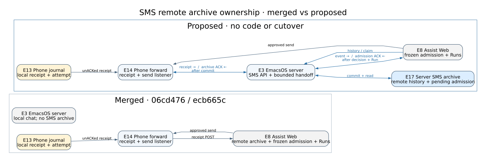

#+TITLE: SMS archive ownership: current and proposed
#+STATUS: Proposal companion — no implementation or cutover

The [[file:architecture.org][merged EmacsOS architecture]] names the components below. At
EmacsOS =main= =06cd476= and Assist =main= =ecb665c=, the PinePhone owns its
local SMS journal and offline history, while Assist owns the remote archive,
history search and Run admission. The [[file:2026-11-06-sms-server-archive-design.org][dated design]] proposes moving only
canonical *remote* history/search to the existing EmacsOS server. The phone's
local journal, physical send path and notifications remain its own.

Edit [[file:architecture-sms-server-archive.dot][the diagram source]] and render
with =dot -Tsvg docs/architecture-sms-server-archive.dot -o docs/architecture-sms-server-archive.svg=.
Solid arrows show the merged path; blue arrows in the proposed view show the
changed path. Both views use the baseline's E IDs. E17 exists only in the
proposal and denotes the server-owned SMS archive and pending admission status,
not a new service or general queue.

* Essential change

Today E14 [[file:../server/emacsos_server/sms_forward.py][SMS forward]] reads exact unacknowledged
receipts from E13, the phone's [[file:../deploy/pinephone/openrc-sms-root][private journal]],
through E11, the fixed helper. E14 posts them directly to E8, Assist Web.
E8 [[https://github.com/pierrel/assist/blob/ecb665c629429803a892f0245b600e266ef5a430/manage/web/threads.py][admits incoming SMS]] using its
[[https://github.com/pierrel/assist/blob/ecb665c629429803a892f0245b600e266ef5a430/assist/events/sms_archive.py][private archive]], frozen routing and ordinary Runs. Only its successful
response lets E14 ACK the exact receipt version in E13. E3
[[file:../server/emacsos_server/app.py][EmacsOS server]] currently has no SMS archive.

The proposal changes the incoming route to E14 → E3/E17 → E8. E3 first commits
the exact receipt and pending admission status in E17. That commit earns the
*phone archive ACK*, even if E8 is unavailable. E3 then retries only E8's
admission of the same incoming event. E8 freezes the route or no-work decision
and persists any required ordinary Run before returning success. Only then does
E3 record the *Assist admission ACK*. Neither ACK represents execution or Run
completion. E3 does not watch execution, and no receiver retries a physical
send to repair an archive.

* Supporting ownership and connections

| Component | Merged responsibility | Proposed difference |
|-----------+-----------------------+---------------------|
| E10/E11/E12/E13 | [[file:../phone-sms-chat.el][Phone history]], [[file:../deploy/pinephone/openrc-sms-root][fixed helper]], ModemManager and local SQLite own offline viewing, modem cleanup, immutable send attempts and receipt versions. | None. Local durability still precedes modem cleanup; =unknown= never authorizes resend. |
| E14 | [[file:../server/emacsos_server/sms_forward.py][Phone forwarder]] retries receipt POSTs to E8 and hosts the authenticated exact-send listener. | E14 posts receipts to E3, checks E3's archive ACK and then ACKs the exact version in E13. The existing E8 → E14 approved-send path remains. |
| E3/E17 | [[file:../server/emacsos_server/app.py][E3]] serves local chat and config functions; no SMS history store exists there. | E3 gains deterministic authenticated SMS ingest/read/search/claim and bounded pending admission forwarding over a private E17 SQLite archive. It does not use the chat checkpoint or config Git store. |
| E8 | Assist owns the [[https://github.com/pierrel/assist/blob/ecb665c629429803a892f0245b600e266ef5a430/manage/web/threads.py][SMS ingress/admission]], [[https://github.com/pierrel/assist/blob/ecb665c629429803a892f0245b600e266ef5a430/assist/events/sms_archive.py][remote history]], subscriptions, approvals and [[https://github.com/pierrel/assist/blob/ecb665c629429803a892f0245b600e266ef5a430/assist/run_service.py][Runs]]. | Keeps a compact global frozen admission decision and all Run/execution/recovery state. Queries E3/E17 for history/search and the one-time outgoing =unknown= claim, using its returned timestamp for E14's exact send request. |

The phone's E10 UI, E11 helper, E12 ModemManager and E13 journal stay outside
the new remote archive dependency. E16's [[file:../phone-notifications.el][local attention]] and
[[file:../phone-assist-notifications.el][Assist alert client]] also stay as mapped in the
merged architecture. Assist's existing immutable Run text and checkpoints may
still contain SMS work snapshots; E17 becomes the owner of canonical remote
search, not of those already-admitted Runs. A missing E3/E17 read is reported as
unavailable, not empty. Outgoing =unknown= keeps its attempt ID and cannot
cause an automatic second send.

This is a review map for a future migration, not deployed behavior. The
[[file:2026-11-06-sms-server-archive-design.org][dated design]] has the failure cases, authentication boundary,
legacy timestamp handling, cutover and rollback contract. No database move,
client change, service configuration or phone action is part of this companion.

* Historical supersessions

The “Evidence and current behavior” section of
=2026-11-06-sms-server-archive-design.org= described PR #94 as separate from its
then-current =c4cf9d9= base. EmacsOS =main= =06cd476= now includes PR #94, so
the current-status fact above replaces only that historical source-status note.
The dated document's proposed ownership and two ACK contract remain proposals.
