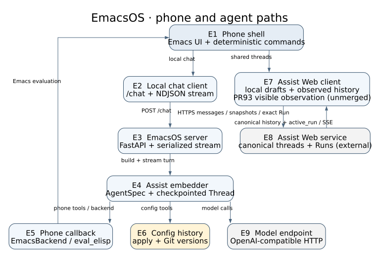
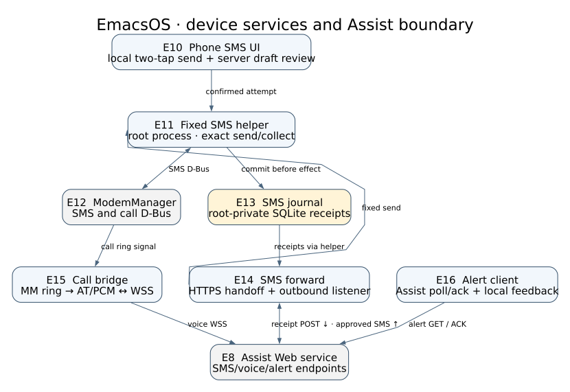

#+title: EmacsOS architecture

This is the EmacsOS component map at merged =main=
=72be51f2fb9579b5ca471944ddc313ce1fbcef6e=. It follows the phone's two
agent paths: local =/chat= through =emacsos-server=, and the client for
canonical Assist Web threads. The client and server code share this repo, but
the Assist package, Assist Web service and model endpoint are external
boundaries. This is a component map, not a function call graph.

Edit [[file:architecture.dot][architecture.dot]] and render with
=dot -Tsvg docs/architecture.dot -o docs/architecture.svg=. The numbered IDs
name the components below. Arrows carry requests, model work or device
actions.

* Component key

** Phone and local chat

- *E1 Phone shell.* [[file:../os.el][os.el]] starts the Emacs UI.
  [[file:../phone-call.el][phone-call.el]], [[file:../phone-sms.el][phone-sms.el]]
  and [[file:../network.el][network.el]] supply deterministic device commands;
  the user can invoke them directly, and the agent can invoke them through
  Emacs evaluation.
- *E2 Local chat client.* [[file:../chat.el][chat.el]] sends =POST /chat= and
  renders bounded NDJSON token/status events without blocking the UI.
  [[file:../emacsos-assist.el][emacsos-assist.el]] also supports file-backed
  conversations through the local server.
- *E3 EmacsOS server.* [[file:../server/emacsos_server/app.py][app.py]] owns the
  FastAPI =/chat= route, phone request identity, a serialized streaming worker
  and state routes: =/clear= and =/forget= discard local conversation state,
  while =/rollback= restores a prior phone Emacs config.
  [[file:../server/emacsos_server/stream.py][stream.py]] converts agent output
  to stream events. It is not Assist Web's durable Run admission service.
- *E4 Assist embedder.* [[file:../server/emacsos_server/app.py][=_build_thread=]]
  creates a fresh =AgentSpec= and =assist.Thread= per local chat turn, with a
  shared SQLite checkpointer. Its two profiles are legacy Emacs control tools
  for the fixed conversation and [[file:../server/emacsos_server/emacs_backend.py][EmacsBackend]]
  for file-backed chat. The latter routes filesystem and shell operations to
  the phone. [[file:../server/emacsos_server/channel.py][channel.py]] supplies
  legacy control tools; [[file:../server/emacsos_server/app.py][=_skill_sources=]]
  declares the EmacsOS skill route for both profiles. Agent construction and
  model work run off the server event loop.
- *E5 Phone callback.* [[file:../server/emacsos_server/channel.py][=eval_elisp=]]
  and [[file:../server/emacsos_server/emacs_backend.py][EmacsBackend]] use
  [[file:../server/emacsos_server/phone.py][phone.call_emacs]] to reach the
  request's phone Emacs server. The callback can inspect or change Emacs state;
  when it invokes a device primitive, E1 executes that concrete command.
- *E6 Config history.* [[file:../server/emacsos_server/channel.py][=get_config=,
  =apply_config= and rollback tools]] work through
  [[file:../server/emacsos_server/config_repo.py][ConfigRepo]] and
  [[file:../server/emacsos_server/apply.py][apply.py]] to verify, install and
  Git-version the phone's Emacs config. This history is server-owned state,
  separate from the conversation checkpoint.

** Shared Assist Web threads

- *E7 Assist Web client.* [[file:../assist-web.el][assist-web.el]] calls the
  authenticated HTTPS phone API, observes Run status and text over SSE, and
  reconciles canonical snapshots. [[file:../assist-web-git.el][assist-web-git.el]]
  handles the separate local Git/SSH thread checkout flow. This path does not
  pass through E3 or create E4's local =assist.Thread=.
- *E8 Assist Web service.* The external Assist service owns the canonical
  thread, Run, approval and Git authority for E7. Its phone API and SSE are
  the cross-repository contract; the EmacsOS client holds a local projection,
  not durable Run truth.
- *E9 Model endpoint.* The local server's embedded Assist Thread selects an
  OpenAI-compatible model using =ASSIST_MODEL_URL=. Inference runs outside
  EmacsOS; E8 has its own model path.

* Device services and durable handoffs

This second view shows the phone-side SMS, call and notification boundaries on
the same merged EmacsOS =main=. E8 keeps its meaning from the first view.
The SMS journal is the phone's durable authority for modem attempts and
receipts; Assist receives a later handoff. The two directions between E14 and
E8 are labeled separately in the key.

Edit [[file:architecture-device.dot][architecture-device.dot]] and render with
=dot -Tsvg docs/architecture-device.dot -o docs/architecture-device.svg=.

** SMS and modem

- *E10 Phone SMS UI.* [[file:../phone-sms.el][phone-sms.el]] stages an exact
  number and body; two local Send taps start an ordinary phone attempt.
  [[file:../assist-web.el][Assist Web review]] brings a server draft to that
  same phone surface and ties its decision to the exact proposal and journal
  identity. [[file:../phone-sms-chat.el][phone-sms-chat.el]] presents local
  history and conversations.
- *E11 Fixed SMS helper.* [[file:../deploy/pinephone/openrc-sms-root][openrc-sms-root]]
  is the privileged, fixed =doas= command for collection, lookup, receipts and
  exact sending. It owns the SQLite transaction before a modem effect; a
  duplicate attempt identity does not send again. The phone UI and E14 use
  this helper rather than sending arbitrary modem commands.
- *E12 ModemManager.* The helper reads incoming SMS and sends outgoing SMS
  through ModemManager D-Bus. [[file:../phone-call.el][phone-call.el]] also
  observes call signals and provides the human call UI. This modem service is
  outside the EmacsOS repository.
- *E13 SMS journal.* The helper's private SQLite =messages= table records
  incoming receipts, outgoing attempts/status and handoff acknowledgment.
  [[file:../deploy/pinephone/openrc-sms-root][=journal= and
  =begin_attempt=]] are its write boundary. Receipt durability precedes
  forwarding; a failed server handoff leaves the local receipt for retry.
- *E14 SMS forward.* [[file:../server/emacsos_server/sms_forward.py][sms_forward.py]]
  reads journal receipts through E11 and POSTs incoming messages and outbound
  outcomes to Assist HTTPS. Its authenticated =/outbound/sms/v1= listener
  accepts an exact server request and invokes the same fixed helper. Assist
  handles approval before that request; the listener checks its shared secret,
  not an approval token. It retries handoff, never modem sending, to repair
  an incomplete receipt.

** Calls and attention

- *E15 Call bridge.* [[file:../server/emacsos_server/call_bridge.py][call_bridge.py]]
  watches ModemManager incoming calls, controls its dedicated AT/PCM path and
  connects to Assist by authenticated WSS =/call=. It is separate from local
  =/chat= and from E10–E14's SMS path. Live-call validation remains held at
  the documented [[file:2026-07-28-voice-call-p3-bridge.org][hardware power gate]];
  this map describes merged code, not a proved sustained call.
- *E16 Alert client.* [[file:../phone-assist-notifications.el][phone-assist-notifications.el]]
  polls the Assist phone API for reasoned alerts and ACKs each exact alert.
  [[file:../phone-notifications.el][phone-notifications.el]] records the local
  reason and requests bounded feedback. This is distinct from E13's local
  incoming-SMS alert claim and from E8's durable alert receipt.
