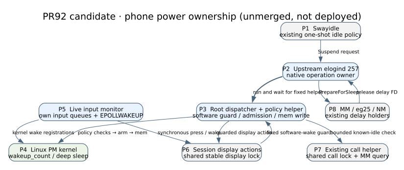

#+TITLE: Native phone suspend review

This branch is an unmerged candidate, not a deployment. This scoped view maps
only the phone power runtime; it does not replace the application/server map.

* Essential change

P1 Swayidle requests suspend through P2 upstream elogind 257. The native owner
performs preparation and waits for P3, the fixed helper. P3 checks the existing
phone policy and owns its call/display locks through the actual kernel write.
Expected refusal logs a successful no-op. Unexpected helper failure keeps the
native fallback contract; there is no crash-proof policy guarantee.

The private provider behavior patch and cross-process input-descriptor import
are removed. P5 keeps its own kernel wake registrations while processing input.
P6's software wake guard, stable display lock and normal display semantics remain.

Edit [[file:phone-power-architecture.dot][the DOT source]] and render with
=dot -Tsvg docs/phone-power-architecture.dot -o docs/phone-power-architecture.svg=.
Blue components change in this candidate; gray components retain their roles.
The arrows show requests and ownership boundaries, not a complete call graph.

* Read the supporting changes

1. *P2 Native package.* [[file:../deploy/pinephone/elogind/APKBUILD][APKBUILD]] and
   [[file:../deploy/pinephone/elogind/README.org][its dependency/activation contract]] pin upstream source and compatibility
   patches. [[file:2026-11-25-elogind-musl-port.org][The research/package record]] distinguishes merged upstream work,
   the open follow-up, local header/build fixes and actual artifact results.
   No sleep behavior is patched.
2. *P3 Admission and writer.* [[file:../deploy/pinephone/openrc-power-monitor::def entry()][entry]] acquires call then stable display locks before runtime reads.
   It validates the current blank state, USB, known call-idle state and wake
   sources, then uses the kernel wakeup-count handshake. Its query children
   cannot inherit its lock descriptors. The actual writer retains those locks.
   [[file:../deploy/pinephone/openrc-suspend-root][The fixed root dispatcher]] retains the software wake/press entry points.
3. *P5 Input processing.* [[file:../deploy/pinephone/openrc-power-monitor::def main()][The monitor]] registers its own input queues before reporting ready, processes
   press/wake synchronously and only then polls again. It preserves hardware
   selection and overflow resynchronization. It does not retain input objects
   after monitor death or inspect another process's descriptors.
4. *P6/P7 Existing coordination.* [[file:../deploy/pinephone/openrc-session-power][Display actions]], [[file:../deploy/pinephone/openrc-session][session startup]] and
   [[file:../deploy/pinephone/emacsos-ui.initd][UI preparation]] share the stable display lock. Startup publishes waking
   before Sway, so it cannot race an older writer through a replacement runtime.
   [[file:../deploy/pinephone/openrc-call-root][Call mutation and idle checks]] retain their existing call lock and known-state
   rules. The helper takes those locks in the same order.
5. *Dependency preflight.* [[file:../deploy/pinephone/openrc-power-monitor::def provider_check()][The existing installer check]] requires the selected package, the installed
   executable actually owning login1 and the fixed sleep configuration. Comparing
   the active executable's inode with the installed file detects an old daemon
   surviving a package replacement without embedding a private ELF digest.

* Checks and their limits

[[file:../tests/test-pinephone-suspend-policy.py][The public-helper fixture]] runs real helper processes, locks and child queries.
It covers normal entry, active/unknown calls, USB/nonblank state, unavailable
state, unsafe/busy locks, counter timeout and a blocked actual write. The
startup/blocked-write case verifies writer-wins exclusion and startup-wins veto.
Its private files/pipe are I/O models, not kernel deep sleep.

[[file:../tests/test-pinephone-native-dependency.py][Dependency tests]] retain configuration and active-provider checks plus the real
initd create-once lock test. [[file:../tests/test-pinephone-openrc-power.sh][Display/input tests]] retain typed packet handling,
overflow and simultaneous-event ordering, guarded display overlap and cleanup.
Their SYS_PTRACE capability is test-only cross-UID inspection; the product no
longer imports foreign descriptors or needs that capability for acquisition.
The old patched-provider and input-import fixtures are deleted.

Actual native-package VM evidence is separate: the standard OpenRC daemon has
been started, a successful no-op prevented entry, the normal test helper entered
and resumed from real S3, and a controlled nonzero exit exercised native fallback.
Preparation, overlap refusal and actual virtual keyboard packets were observed.
That fixed test helper is not phone hardware policy acceptance. A VM has no
EG25, so the actual phone policy should refuse that unavailable hardware.
Both isolated and deployed-composition UI validation remain required before
publication or target activation. Physical modem/call/SMS wake remains separate.
